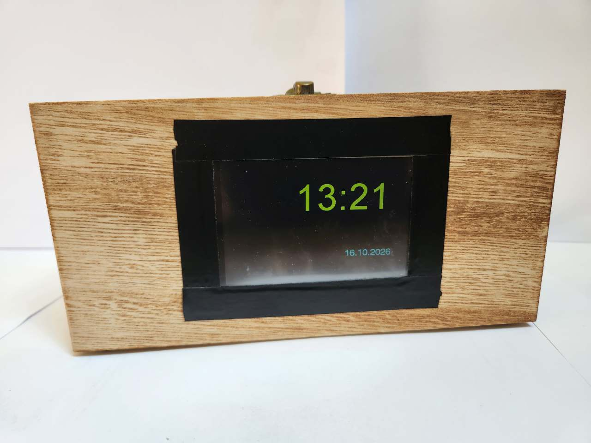

[![Contributors][contributors-shield]][contributors-url]
[![Forks][forks-shield]][forks-url]
[![Stargazers][stars-shield]][stars-url]
[![Issues][issues-shield]][issues-url]

 

   
   <h1>Lichtwecker mit Touchdisplay und ESP32</h1>

 

# Lichtwecker Version 1
Auf der Suche nach dem passenden Lichtwecker, bin ich der Meinung das es nichts gutes auf dem Markt gibt. Darum selber machen!

## Features
-   WIFI
    -   NTP-Zeitabgleich mit Sommerzeitumstellung
    -   Webserver für Weckeinstellungen, Statusanzeige, Lichtfunkiton und Einstellung der Radiostream Quellen 

**[Basis ist ein ESP32 D1 Mini von AZ-Delivery] (https://www.az-delivery.de/products/esp32-d1-mini-nodemcu-wifi-modul-esp-32-bluetooth-internet-entwicklungsboard-mit-usb-c-anschluss-kompatibel-mit-arduino-und-kompatibel-mit-wemos-d1-mini?_pos=2&_psq=d1&_ss=e&_v=1.0)**

**[SPI Display 3,5" von TFT Touch 320x480 von Binghe](https://www.amazon.de/dp/B0D6B9M4ZH?ref=ppx_yo2ov_dt_b_fed_asin_title)**
Adafruit I2S 3W Class D Amplifier Breakout - MAX98357A 

<!-- 

    
    
DroneBridge for ESP32 can be used to control drone swarms at a low cost.

 

DroneBridge for ESP32 supports ESP-NOW LR, enabling ranges of more than 1km with external receiving antennas. The number of drones is only limited by the channel capacity and the ESP32s processing power. All data is encrypted using AES256-GCM.

## Drone Light Show Edition (DLSE)

Special version that is optimised to work for Drone Shows using [Skybrush](https://skybrush.io/)    
Check [drone-bridge.com](https://drone-bridge.com) to get the latest release!

-   Support for Skybrush
-   Remote Power Management (sleep, wakeup) of the show drone
-   Lots of additional checks to improve safety and reliability
-   [Open Source Commercial Support Suite](https://github.com/DroneBridge/DLSECommercialSupportSuite) to help you flash, manage & maintain your drones efficiently. Script your own tools following the given examples using the DLSE API.
-   Over The Air (OTA) Updates for the ESP32
-   WiFi6 (OFDMA) & 5GHz support on supported ESP32 chips
-   ESP32-C3, ESP32-C5 & ESP32-C6

## Hardware

**Officially supported and tested boards:**  
Do the project and yourself a favour and use one of the officially supported and tested boards below.   
These boards are very affordable, have everything you need, and are also very compact. Perfect for use on any drone. 

**[You can find more info on how to get the official boards here!](https://dronebridge.gitbook.io/docs/dronebridge-for-esp32/hardware-and-wiring#officially-supported-boards)**

[For further info please check the wiki!](https://dronebridge.gitbook.io/docs/dronebridge-for-esp32/hardware-and-wiring)

## Installation/Flashing using precompiled binaries

[It is recommended that you use the official online flashing tool!](https://drone-bridge.com/flasher/)

In any other case, there are multiple ways how to flash the firmware.  
**[For further info please check the wiki!](https://dronebridge.gitbook.io/docs/dronebridge-for-esp32/installation)**

## Wiring

1.  Connect the UART of the ESP32 to a 3.3V UART of your flight controller. It is not recommended to use the ESP32s pins that are marked with TX & RX since they often are connected to the internal serial ouput. Go for any other pin instead!
2.  Set the flight controller port to the desired protocol.

**Check out the manufacturer datasheet! Only some modules can take more than 3.3V. Follow the recommendations by the ESP32 board manufacturer for powering the device**  
**[For further info please check the wiki!](https://dronebridge.gitbook.io/docs/dronebridge-for-esp32/hardware-and-wiring)**

## Configuration
1.  Connect to the WiFi `DroneBridge ESP32` with password `dronebridge`
2.  In your browser type: `dronebridge.local` (Chrome: `http://dronebridge.local`) or `192.168.2.1` into the address bar.
 **You might need to disable the cellular connection to force the browser to use the WiFi connection**
3.  Configure as you please and hit `save`

**[For further info please check the wiki!](https://dronebridge.gitbook.io/docs/dronebridge-for-esp32/configuration)**

## Use with QGroundControl, Mission Planner or any other GCS

-   The ESP will auto-send data to all connected devices via UDP to port 14550. QGroundControl should auto-connect using UDP
-   Connect via **TCP on port 5760** or **UDP on port 14550** to the ESP32 to send & receive data with a GCS of your choice. 
-   **In case of a UDP connection the GCS must send at least one packet (e.g. MAVLink heart beat etc.) to the UDP port of the ESP32 to register as an endpoint. Add ESP32 as an UDP target in the GCS**
-   Manually add a UDP target using the web interface

## Further Support

For questions or general chatting regarding DroneBridge for ESP32 please visit the Discord channel  

[contributors-shield]: https://img.shields.io/github/contributors/DroneBridge/ESP32.svg?style=for-the-badge
[contributors-url]: https://github.com/DroneBridge/ESP32/graphs/contributors
[forks-shield]: https://img.shields.io/github/forks/DroneBridge/ESP32.svg?style=for-the-badge
[forks-url]: https://github.com/DroneBridge/ESP32/network/members
[stars-shield]: https://img.shields.io/github/stars/DroneBridge/ESP32.svg?style=for-the-badge
[stars-url]: https://github.com/DroneBridge/ESP32/stargazers
[issues-shield]: https://img.shields.io/github/issues/DroneBridge/ESP32.svg?style=for-the-badge
[issues-url]: https://github.com/DroneBridge/ESP32/issues -->
